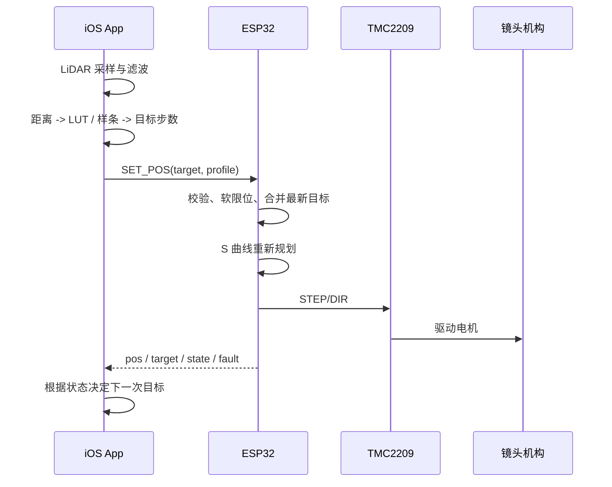

# 跟焦器控制架构与运动规划

## 目标

本项目的目标是把 ESP32-S3 固件做成一个可靠的实时运动控制器，把 iOS App
（Swift 功能层 + Flutter UI）建立在稳定、可复用的接口上。

核心原则：

> 手机决定“镜头应该到哪里”，ESP32 决定“怎样安全、平滑、可靠地到那里”。

手机端负责雷达和镜头语义，固件不需要理解距离、人物或镜头焦距。

## 总体架构


## 职责边界

### 手机 App

手机是高层控制器，负责：

- LiDAR 距离采样；
- 中值滤波、低通滤波和异常值剔除；
- 目标丢失和跟踪状态；
- 距离到镜头位置的 LUT / 样条映射；
- 自动跟焦死区；
- 跟焦灵敏度和用户体验策略；
- 发送最新目标位置，而不是上传完整电机轨迹。

手机不应承担：

- 直接生成 STEP 脉冲；
- 假定 UDP 包一定到达；
- 绕过固件软限位；
- 把每个雷达采样都当成一个必须执行的独立运动；
- 把软件 `pos` 当成真实闭环位置。

### ESP32 固件

ESP32 是实时运动控制器，负责：

- UDP 报文解析和长度校验；
- 目标位置的软限位夹紧；
- `SET_POS` 最新目标合并；
- `JOG` 相对目标累计；
- STOP 和使能状态；
- 速度、加速度、减速度和 jerk 上限；
- 由硬件定时器 ISR 生成 STEP 脉冲；
- TMC2209 参数与故障诊断；
- 通信断开后的安全策略；
- 返回位置、目标、运动、限位和故障状态。

固件不应承担：

- LiDAR 过滤；
- 人脸识别；
- 镜头距离模型；
- 依赖 Wi-Fi 延迟来保证运动安全。

## 当前实现

### 运动单位

当前电机按 0.9° 步距角计算：

```text
整步/圈 = 360 / 0.9 = 400
脉冲/圈 = 400 × TMC2209 细分
```

默认 1/16 细分时：

```text
1 圈 = 6400 脉冲
+800 = 0.125 圈
+80  = 0.0125 圈
```

对应实现：

- Swift 功能层：`ios/FollowFocusCore/Sources/FollowFocusCore/MotorCal.swift`
- 固件：`firmware/src/motor.cpp`

### 当前命令

协议是 12 字节小端包：

```text
magic uint8 = 0x46
cmd   uint8
flags uint8
pad   uint8
a     int32
b     int32
```

| 命令 | 含义 | 参数 |
| --- | --- | --- |
| `SET_POS` | 移动到绝对位置 | `a = target steps` |
| `JOG` | 累计相对移动 | `a = delta steps` |
| `STOP` | 停止并对齐当前位置 | 无 |
| `ENABLE` | 使能或禁用 | `a = 0/1` |
| `SET_LIMITS` | 设置软限位 | `a = min, b = max` |
| `SET_SPEED` | 设置巡航速度和加速度 | `a = hz, b = accel` |
| `QUERY` | 请求状态 | 无 |
| `TMC_QUERY` | 请求 TMC 诊断 | 无 |
| `TMC_SET` | 修改 TMC 参数 | `a = key, b = value` |
| `HOME` | 将当前静止位置建立为可信原点 | 无物理限位开关时为手动校零 |
| `DISCOVER` | 设备发现，回 32 字节 `0x84` | 无 |

请求包的 `flags`（第 3 个字节）位 0 = `FF_REQ_LATCH`：该次 `SET_POS`/`JOG` 采用
**单次锁存**语义，不纳入 1000 ms 通信看门狗，发一次即可跑完。位 0 为 0 时是默认的
**流式**语义，必须持续发新目标。完整 wire 契约（回包布局、回包数量不对称、已验证的
十六进制样例、上位机检查清单）见 [PROTOCOL.md](PROTOCOL.md)。

### 请求序号回显

12 字节包的第 4 个字节原来是保留字节，现在作为可选请求序号：

```text
手机发送：pad = sequence (1..255)
固件回复：status.pad = 相同 sequence
旧客户端：pad = 0，固件仍兼容
```

Swift 功能层的 `MotorLink` 会自动为每个发送的控制包分配序号，并用它判断收到的
状态是否对应某一次 `SET_POS`、`JOG` 或 `STOP`，从而区分 UDP 丢包、设备无响应和
命令已被固件处理。序号回显只证明命令
已到达并产生了状态回复，不代表电机已经完成运动；完成状态仍需比较
`pos` 与 `target` 以及 `moving`。

### 命令结果

状态包 flags 的高 3 位现在携带最近一次命令结果，低 5 位原有状态
保持不变：

| 值 | 含义 |
| --- | --- |
| `0` | 空闲 |
| `1` | 已接受 / 执行中 |
| `2` | 已完成 |
| `3` | 已被软限位夹紧 |
| `4` | 已拒绝（例如未使能） |
| `5` | 已停止 |

结果与请求序号一起使用。结果表示最近一次命令的状态，不是历史队列；
`accepted` 只有在 `pos == target` 且 `moving == false` 后才变成
`completed`。`STATUS` 和 `STATUS_V2` 共用同一次提升，因此两种包的
`result` 始终一致，客户端不应依赖它们之间的差异。

### 两种目标语义

`SET_POS` 和 `JOG` 必须保持不同语义：

```text
SET_POS：绝对目标，新的目标覆盖旧目标，适合滑条和自动跟焦
JOG：以收到命令时的实际软件位置为基准，加上 delta 后立即重新规划，
适合 +800 / -800；不会继承一个尚未完成的远距离绝对目标。
```

当前固件由主循环更新目标和规划速度，由 ESP32 硬件定时器 ISR
输出 STEP。每输出一个实际脉冲才推进一次 `pos`，因此 `+8` 就是
8 个脉冲；`JOG` 基于收到命令时的位置生成局部目标，不依赖脉冲队列。
高频 `SET_POS` 仍采用最新目标覆盖语义，避免积累过期目标。

### 当前反馈的限制

当前 `pos` 是步进脉冲推算的位置，不是编码器反馈：

```text
pos 变化 != 机械轴一定真实转动
```

真实运动还需要结合 TMC2209 的：

```text
STST、TSTEP、CS_ACTUAL、DRV_STATUS
```

当前 UDP 状态已经返回：

```text
enabled
moving
uart_ok
standby
limited
pos
target
```

### 位置可信度与手动 HOME

上电、复位或禁用电机后，`positionTrusted = false`。在没有物理限位
开关的版本中，`HOME` 不会自动寻找机械端点，而是在电机完全停止后把
当前软件位置设为 0，并将 `positionTrusted` 设为 true。未来接入限位
开关后，可以复用同一命令语义扩展为真实回零流程。

`STATUS_V2` 在保留旧 12 字节状态包的同时返回：

```text
position_trusted
fault            (当前恒为 0，故障只能看 TMC_DUMP 的 drv_flags / uart_ok)
reserved         (位 0 = FF_V2_WATCHDOG_ARMED，见 P0-3)
```

旧客户端继续使用 `STATUS`，新客户端应优先读取 `STATUS_V2`。

两个容易误判的点：`ENABLE(0)` 会清除 `positionTrusted`；而**待机释放扭矩不会清**
（刻意的例外），所以长时间待机或人工动过镜头后，开环 `pos` 仍被标记可信，必要时重新
`HOME`。字段级细节见 [PROTOCOL.md](PROTOCOL.md)。

## S 曲线 / jerk 运动 profile

### 为什么需要

传统梯形速度规划是：

```text
加速度突然增加 -> 匀速 -> 加速度突然变为负值
```

自动跟焦更适合：

```text
jerk 受限的 S 曲线
```

加速度逐步变化，减少：

- 起步和停止冲击；
- 齿轮、皮带和镜头环震动；
- 失步风险；
- 自动跟焦画面跳动。

### 建议 profile 参数

协议层使用步单位，手机 UI 可以显示圈单位并在发送前换算：

```text
mode          = TRAPEZOID / S_CURVE
start_speed   = steps/s
max_speed     = steps/s
max_accel     = steps/s²
max_decel     = steps/s²
jerk          = steps/s³
```

建议新增：

```text
SET_PROFILE
GET_PROFILE
SAVE_PROFILE
RESET_PROFILE
```

调试阶段可以先使用现有 12 字节包拆分设置；正式 Swift 接口建议使用带
`version`、`length` 和校验的完整 profile 包。

推荐的职责：

```text
手机：发送最新 SET_POS 和选择 profile
固件：从当前运动状态重新规划到最新目标
```

不要让手机发送大量离散轨迹点来模拟样条。那会把 Wi-Fi 延迟和丢包重新引入
实时运动控制 —— 手机侧只该决定"到哪个位置"，规划在固件里做。

### 短距离运动

短距离通常达不到最高速度，应自动退化为三角 S 曲线：

```text
平滑加速 -> 平滑减速
```

不能因为没有达到 `max_speed` 就认为运动异常。

## 建议的固件改进路线

### P0：实时可靠性

1. **保持单一脉冲输出路径**
   - 当前由硬件定时器 ISR 直接输出 STEP，已经移除
     FastAccelStepper/RMT 及 `manageSteppers()`。
   - 后续修改运动规划时必须保持“实际输出脉冲后才推进 `pos`”这一约束。

2. **命令确认与结果状态**
   - 请求序号回显和 3-bit 命令结果已经加入，保持 12 字节协议兼容。
   - 仍需在更高层补充持久的故障码和通信超时状态。

3. **通信超时安全策略** —— **已实现**
   - 固件记录最近一次有效控制包时间。
   - 策略空间：仅停止自动跟焦目标 / 停止运动 / 禁止继续追踪 / 保持当前位置并释放电机。
   - 默认不应因为短暂丢一个 UDP 包就急停，但长时间失联必须安全。
   - 当前实现：`SET_POS`/`JOG` 刷新 1000 ms 看门狗，超时后停止运动、清 `armed`、
     结果置 `STOPPED`。控制包 `flags` 位 0（`FF_REQ_LATCH`）把该次移动切换为
     **单次锁存**，不纳入看门狗；`STATUS_V2.reserved` 位 0 暴露 `ARMED` 状态。
   - 因此两类会话可以在同一条协议上各取所需：自动跟焦用流式并持续重发最新
     `SET_POS`（建议 200–500 ms，重复目标是幂等的），一次性长行程用锁存位。
   - 注意 App 侧仍需实现"持续重发"：只在目标变化时发送会截断 >1 s 的行程。

4. **不要把开环位置当作真实运动确认**
   - 将 TMC `TSTEP/STST` 异常纳入状态机。
   - 区分：
     `命令已接受`、`正在输出脉冲`、`驱动器静止`、`疑似堵转`。

### P1：运动能力

1. 增加 profile 配置和 NVS 持久化；
2. 速度、加速度、减速度、jerk 做固件上限校验；
3. `SET_POS`、`JOG`、`STOP` 共用明确的目标状态机；
4. 为软限位返回明确错误/夹紧后的目标；
5. 将恢复逻辑从常规路径中隔离，避免把脉冲输出重建作为正常运动流程；
6. 增加运动状态字段：当前 profile、故障码、恢复计数。

### P2：位置可信度

1. 增加上电回零或手动建立原点；
2. 保存“位置是否可信”标志，而不是重启后直接假设真实位置为 0；
3. 支持机械限位或原点传感器；
4. 支持减速比、皮带/齿轮比；
5. 支持反向间隙补偿；
6. 后续如有硬件条件，增加编码器闭环。

## 推荐的最终工作流



## 结论

当前架构方向是正确的：

```text
手机 = 感知、理解、映射
ESP32 = 实时、安全、平滑地执行目标
TMC2209 = 电流、细分和驱动诊断
```

下一步不应把雷达算法移入固件，也不应让手机上传完整步进轨迹。
优先级应是：

```text
单一步进调度
-> 命令确认与故障状态
-> 通信失联安全策略
-> S 曲线 profile
-> 回零与位置可信度
-> 传动比、间隙和闭环扩展
```
